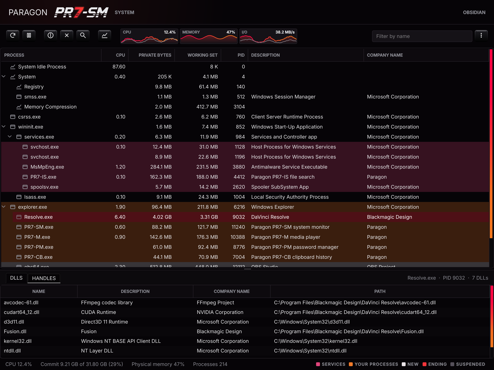
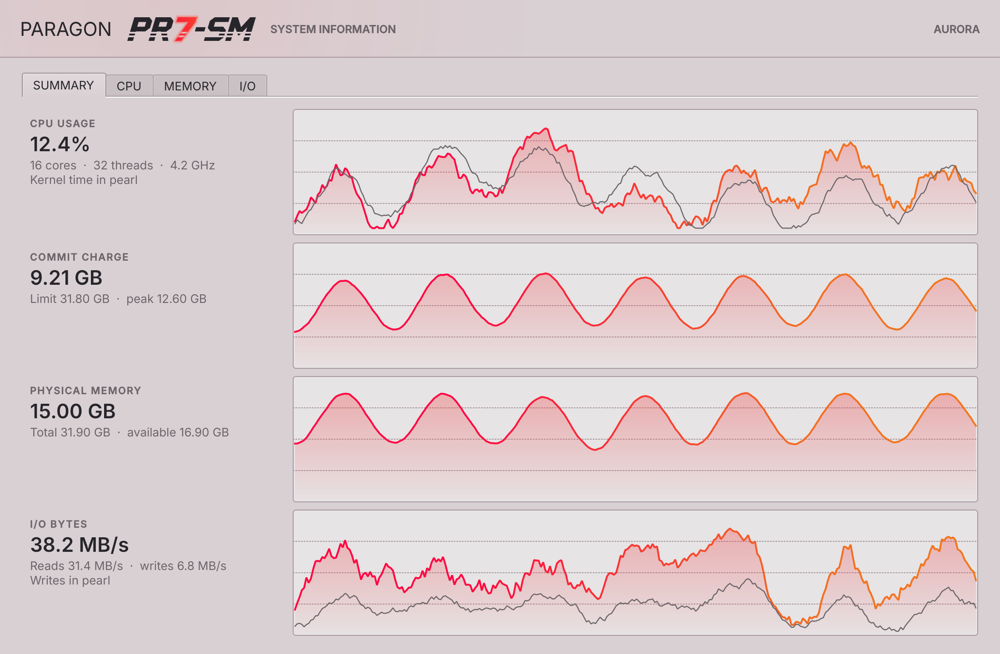

# Paragon PR7-SM

A system monitor that works the way **Process Explorer** works, in the Paragon family look (PR7-Z, PR7-W, PR7-L,
PR7-F, PR7-E, PR7-R, PR7-P, PR7-M, PR7-Q, PR7-U, PR7-DU, PR7-CB, PR7-IS, PR7-PM). Python and PySide6.

## What it does

- Every process, under the process that started it, refreshed every second: CPU, private bytes, working set, PID,
  description and company (from each program's file details).
- Process Explorer's colours in the family's: **services pink**, **your own processes orange**, **new** processes
  pearl and **ending** ones red for a moment, **suspended** ones grey.
- Click a column to sort by it (click again for the other way, a third time for the tree back); filter by name.
- The lower pane: the selected process's **DLLs** or its **handles** (open files and network connections).
- **Del** ends a process, **Shift+Del** ends it and everything it started, **Enter** opens its Properties, **Space**
  pauses, **Ctrl+F** finds which process has a file or DLL open, **Ctrl+I** opens System Information.
- Properties: path, command line, folder, parent, user, start time, priority, threads, connections, environment,
  and its own CPU, memory and I/O graphs; open its folder (in PR7-E when installed), suspend, set priority, end it.
- System Information: CPU (each core too, kernel time in pearl), commit charge, physical memory, disk I/O.
- **Replace Task Manager** (Options): Ctrl+Shift+Esc opens PR7-SM. Windows asks for permission once; uninstalling
  puts Task Manager back.
- Other users' and system processes show what Windows allows; *Show details for all processes* restarts PR7-SM as
  administrator.

## Building

`pip install -r requirements.txt -r requirements-dev.txt`, `python -m pytest`, `pyinstaller pr7sm.spec`, then Inno
Setup 6 on `installer/pr7sm.iss`. CI does all of it on Windows; a pushed new version publishes itself.
